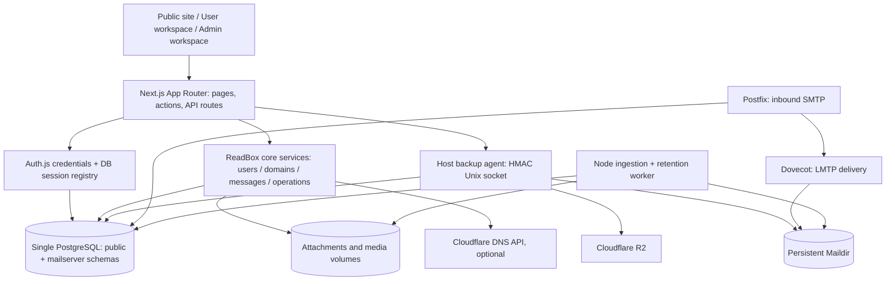
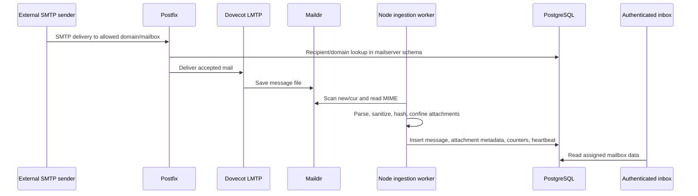

# ReadBox architecture and data flows

**Source baseline:** `488f565a21f4434ed5a066c5d46794637520ddec` (documentation-only successor of deployed executable `9c3d99d4...`). The active product is a Next.js 16 App Router + React 19 application with Node.js 22 workers, a **single PostgreSQL** database managed through Prisma, Maildir file storage, and optional mailserver/backup Docker profiles.

## Component architecture

The line between `SMTP` and `LMTP` represents **inbound delivery**, not outgoing mail. The backup agent is **host-only**, not a publicly exposed API. Cloudflare interactions apply only to explicitly configured/selected zones; Manual Mode omits DNS publishing.

## Browser and server boundaries

- Public pages in `src/app/page.tsx`, `contact/`, `privacy/`; protected route groups `(workspace)/users` and `(workspace)/vcon`.
- UI components in `src/components/`; Next.js server actions in route-local `actions.ts` files.
- Business logic under `src/core/`; most stateful services require authorization context, Prisma client and scoped object IDs.
- Authentication in `src/auth.ts` and `src/core/auth/`, using Credentials + Argon2 and a DB-backed active session registry. Admin and ordinary account records have separate identity paths.
- File-backed message/attachment bytes are **not** stored as whole MIME objects in PostgreSQL. PostgreSQL persists message text, sanitized HTML, metadata and storage references.

## Inbound message pipeline

Source: `deployment/mailserver/{postfix,dovecot}/`, `src/core/mailserver/pg-adapter.ts`, `src/core/ingestion/{service,parser,sanitizer,attachments}.ts`, `src/workers/ingestion.ts`, `src/core/messages/service.ts`.

## Domain provisioning

- Manual path: create disabled domain → admin provisions DKIM with Cloudflare publish OFF → escrow-gated public TXT → manual zone export → routing DNS check → activation.
- Automatic path: selected active Cloudflare zone validation → escrow-gated DKIM → additive conflict-safe DNS publish/readback → DNS routing check → activation or pending result.
- DKIM public key readiness and authoritative DKIM TXT visibility are separate states. `signing: inactive` is intentional for this inbound-only product.

## Backup and updates

Admin server actions use authenticated private agent RPC for encrypted backups, scheduled R2 uploads and guarded restore. A separate approved host updater takes an encrypted pre-update snapshot before Git fast-forward and Compose rebuild. Neither the browser nor Next.js has unbounded shell access.

**See:** [Security](security.md), [API](api-reference.md), [Database](database-schema.md), [Deployment](building-packaging.md).
