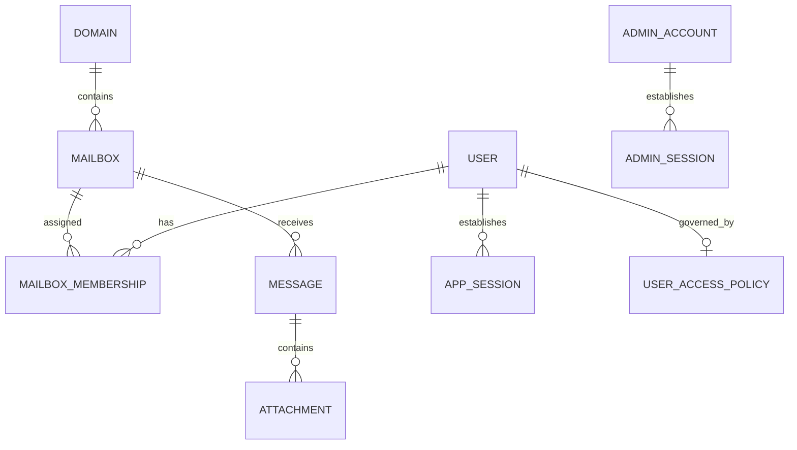

# PostgreSQL schema and persistence model

**Authoritative source:** `prisma/schema.prisma` at the documented source baseline, with **18 Prisma models**. There is **one PostgreSQL database**; a separate `mailserver` schema/views and least-privilege database lookup role serve Postfix rather than introducing another database.

## Core Prisma models

| Model | PostgreSQL table | Key responsibility |
|---|---|---|
| `User` | `users` | Ordinary accounts, hashed passwords, status and login history |
| `AdminAccount` | `admin_accounts` | Independent admin credentials and forced-reset status |
| `AdministratorProfile` | `administrator_profiles` | Legacy/profile administrator relationship |
| `AdminSession` | `admin_sessions` | Admin active hashed session token, expiry and client metadata |
| `AppSession` | `app_sessions` | User active hashed session token, expiry and client metadata |
| `PasswordResetToken` | `password_reset_tokens` | User reset token hash and expiry |
| `AdminResetToken` | `admin_reset_tokens` | Admin reset token hash and expiry |
| `LoginAttempt` | `login_attempts` | Login attempts and lockout monitoring |
| `UserAccessPolicy` | `user_access_policies` | Per-user domain allowlist, mailbox limit, permissions and retention |
| `UserControlSettings` | `user_control_settings` | Site-wide registration and user governance policy |
| `Domain` | `domains` | Domain UUID/name, status, DNS verification, default flag and bound zone metadata |
| `Mailbox` | `mailboxes` | Email address/local part, domain link, status, counters and Maildir path |
| `MailboxMembership` | `mailbox_memberships` | User-to-mailbox assignment and assigning user |
| `Message` | `messages` | Per-mailbox indexed MIME data, sanitized HTML/text, read/deletion state, source hash |
| `Attachment` | `attachments` | Attachment UUID, safe name, MIME, digest and confined storage path |
| `AuditLog` | `audit_logs` | Actor, action, target and sanitized details |
| `ServiceHeartbeat` | `service_heartbeats` | Worker/service heartbeat status |
| `SiteSettings` | `site_settings` | Branding, site contact and footer content |

## Relationships and storage boundaries

The diagram uses concept aliases for actual Prisma models (`MailboxMembership`, `AdminAccount`, etc.). PostgreSQL stores indices and metadata, **not all original Maildir MIME bytes or attachment file contents**. Those bytes live on persistent volumes at configured paths. Deleting a database record alone is not equivalent to safe file cleanup.

## Mailserver schema

`prisma/migrations/20261115000000_mailserver_schema_and_roles/migration.sql` and later migrations define same-database mailserver routing tables/views and lookup roles. `src/core/mailserver/pg-adapter.ts` implements the read-only Postfix adapter and controlled domain/mailbox synchronization. Avoid introducing MariaDB/MySQL/SQLite even if historical `reference/MailStack` documentation mentions them.

## Migration policy

The tracked migration directory includes seven ordered migration directories through `20261117010000_postfix_login_identity`. The production entrypoint uses `prisma migrate deploy` on boot (with a bounded retry unless explicitly skipped for secondary workers). **Never edit an already applied migration**; add a new migration through an approved phase and rehearsal. Check `npm run db:status` against a disposable authorized target before executing `db:migrate`.

**Sources:** `prisma/schema.prisma`, `prisma/migrations/`, `src/core/database/client.ts`, `src/core/mailserver/pg-adapter.ts`, `src/core/ingestion/service.ts`.
